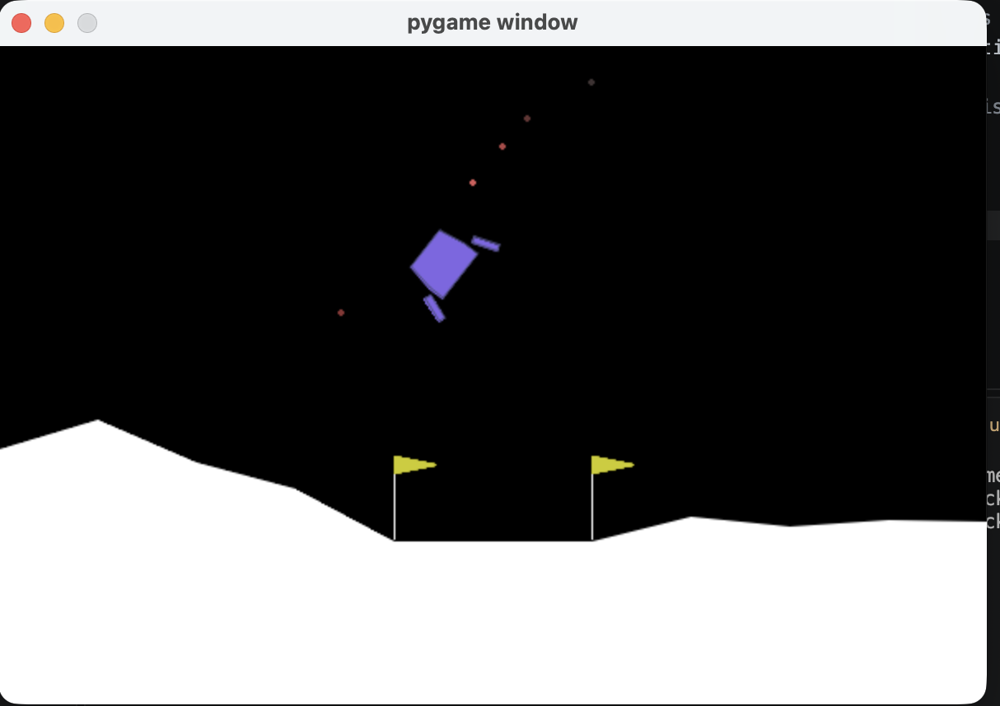

Copy the following into your `README.md` file:

Writing

# Lunar Lander: Reward Engineering for Reinforcement Learning



## Overview

Following a Robot Learning course, this project explores the fundamentals of reward shaping and investigates how reward design influences the learning efficiency and landing performance of reinforcement learning agents in simulated spacecraft landing tasks.

Using Gymnasium's `LunarLander-v3` environment, I train and evaluate agents under different reward formulations, ranging from the environment's default reward to custom shaping functions designed to encourage stable descent, reduced touchdown velocity, accurate positioning, and fuel-efficient control.

The experiments compare learning speed, landing success rate, crash frequency, touchdown conditions, and control efficiency to understand how reward design influences the behaviour learned by an autonomous agent.

## Research Question

**How does reward shaping affect the sample efficiency, stability, and reliability of reinforcement learning for autonomous landing?**

## Planned Experiments

- Establish a baseline using the environment's default reward function.
- Design custom reward functions that encourage safe and controlled descent.
- Investigate potential-based reward shaping and its implications for policy optimality.
- Train agents under consistent experimental settings and across multiple random seeds.
- Compare learning curves, landing success rates, touchdown conditions, and control efficiency.
- Evaluate whether learned policies remain effective under disturbances and variations in initial conditions.

## Requirements

- macOS
- Git
- [uv](<https://docs.astral.sh/uv/>) for Python and dependency management
- Python 3.12, managed by `uv`

## Setup

### 1\. Clone the repository

```
git clone https://github.com/jt-manful/lunar-lander.git
cd lunar-lander
```

### 2\. Install dependencies

Synchronize the project environment using the committed dependency configuration:

```
uv sync
```

This creates or updates the local virtual environment and installs the dependencies specified by `pyproject.toml` and `uv.lock`.

If setting up the project for the first time and dependencies have not yet been configured, run:

```
uv init --python 3.12
uv add "gymnasium[box2d]" stable-baselines3 numpy matplotlib tensorboard
```

If Box2D requires native compilation on macOS, install SWIG first:

```
brew install swig
uv sync
```

### 3\. Verify the environment

Check that Lunar Lander can be initialized:

```
uv run python check_env.py
```

### 4\. Run an experiment

Run the main experiment script:

```
uv run python main.py
```

To run a specific experiment:

```
uv run python experiments/base-experiment.py
```

If a script supports command-line arguments, inspect its options with:

```
uv run python main.py --help
```

**Note:** Run commands from the repository root. The `uv run` command automatically uses the project's managed environment.

## Technology Stack

- **Python** — experiment implementation and analysis
- **Gymnasium** — simulation environment and reinforcement learning interface
- **Stable-Baselines3** — reinforcement learning algorithms, including PPO
- **PyTorch** — neural network training
- **NumPy** — numerical computation
- **Matplotlib** — learning curves and experiment visualizations
- **TensorBoard** — training metrics and experiment monitoring
- **uv** — Python environment and dependency management

## Evaluation Metrics

The experiments will use the following metrics to compare reward formulations:

- **Sample efficiency:** How quickly an agent learns an effective policy.
- **Landing success rate:** The proportion of episodes that result in a successful landing.
- **Crash frequency:** How often an agent crashes or fails to land safely.
- **Touchdown conditions:** The lander's velocity, orientation, and stability at contact.
- **Control efficiency:** How effectively the agent uses its available control actions.

Results should be evaluated across multiple random seeds to account for variability in training and environment initialization.

## Scope

The initial implementation focuses on the 2D Lunar Lander environment provided by Gymnasium.

A potential extension is a custom rocket-landing environment with more explicit thrust, fuel-consumption, and touchdown constraints.

The goal is to evaluate reward shaping empirically rather than assume that a more elaborate reward function necessarily produces a better controller.

## Expected Deliverables

- A reproducible reinforcement learning training pipeline.
- Implementations of baseline and shaped reward functions.
- Visualizations of learning curves, agent behaviour, and landing trajectories.
- Quantitative comparisons of reward formulations and training performance.
- An analysis of reward-shaping trade-offs, limitations, and experimental findings.

## Resources

- [Gymnasium Lunar Lander documentation](<https://gymnasium.farama.org/environments/box2d/lunar_lander/>) — environment dynamics, observations, actions, and default rewards.
- [Gymnasium documentation](<https://gymnasium.farama.org/>) — environment interfaces and interaction patterns.
- [Stable-Baselines3 documentation](<https://stable-baselines3.readthedocs.io/>) — reinforcement learning algorithms and training workflows.
- [uv documentation](<https://docs.astral.sh/uv/>) — Python project and dependency management.