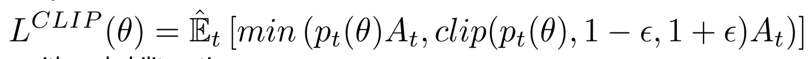

# Learning Doc

# 21.Oct.2026
this document will serve as a log for the my learning journey for this project. First I establish what the goal is goal is and then try to understand control policies and how to go about implementting. I also want to use PPO whicn I also lernt in class.

# Description of the Lander Env
The environment is a classic rocket trajectory optimization problem. According to Pontryagin’s maximum principle, it is optimal to fire the engine at full throttle or turn it off. This is the reason why this environment has discrete actions: engine on or off.

If the lander is falling toward the surface. At each timestep, the agent observes its position, velocity, angle, and angular velocity. It chooses an action, the physics simulator updates the lander's motion, and the environment returns a reward.

The agent is learning a **control policy** that uses observations to choose actions that maximize expected cumulative reward.

so the  agent is not necessarily learning the laws of gravity from scratch. The simulator already implements the physics.

relearning the basisc:

State:

The state is an 8-dimensional vector: the coordinates of the lander in x & y, its linear velocities in x & y, its angle, its angular velocity, and two booleans that represent whether each leg is in contact with the ground or not.

Action: 

There are four discrete actions available:
- 0: do nothing

- 1: fire left orientation engine

- 2: fire main engine

- 3: fire right orientation engine

Rewards:

After every step a reward is granted. The total reward of an episode is the sum of the rewards for all the steps within that episode.

For each step, the reward:

- is increased/decreased the closer/further the lander is to the landing pad.

- is increased/decreased the slower/faster the lander is moving.

- is decreased the more the lander is tilted (angle not horizontal).

- is increased by 10 points for each leg that is in contact with the ground.

- is decreased by 0.03 points each frame a side engine is firing.

- is decreased by 0.3 points each frame the main engine is firing.

The episode receive an additional reward of -100 or +100 points for crashing or landing safely respectively.

An episode is considered a solution if it scores at least 200 points.

First approach: Q-learning
followed the a similar code structure that was used in the blackjack example of openai gym however i run into a seriois problem the lunar landar has 8 state obersations.  the continuous observations make it a difficult problem for a Q-table.

the tabular Q-learning implementation discretizes the observations into bins, which makes the state space large and the learned values relatively sparse. Your learning rate, discretization bounds, and exploration schedule can all affect performance.

this approach produces poor perfomrance and cannot be used as a baseline for our reward shaping experminents

then i remembered why we dont use tables for continous envs

Next I look at stocathic methods specifically 
-A2C
- PPO

From the lecture ppo solves the issues that are faced with stochastic gradient descent methods. 
Proximal Policy Optimization (PPO)
[Schulman et al. 2017]
■ Issue:
● It was observed empirically that smaller policy updates during training are
more likely to converge to an optimal solution, but this can take long
● A too-big step in a policy update can result in falling off the cliff (getting a bad
policy) and taking a long time or even having no possibility to recover
■ Idea: Improve the training stability of the policy by limiting the change you make
to the policy at each training epoch

